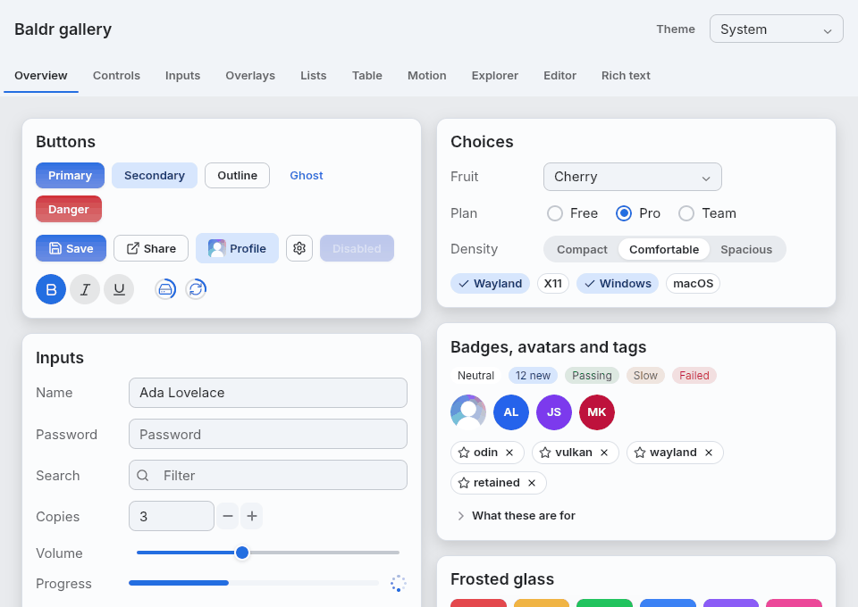
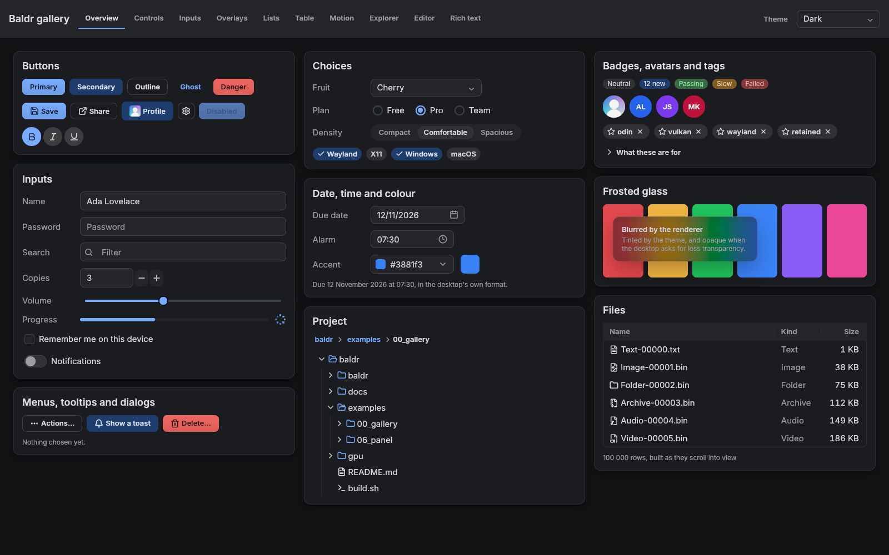
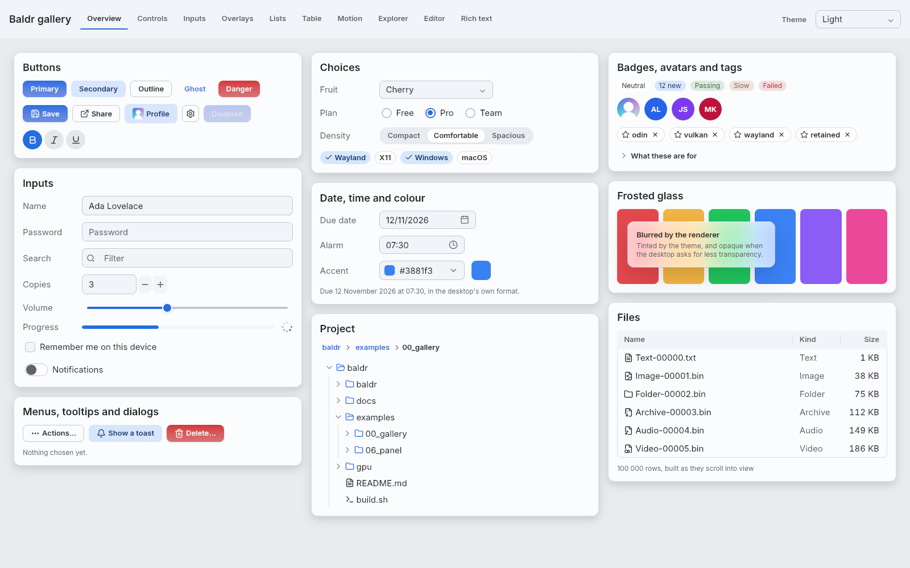
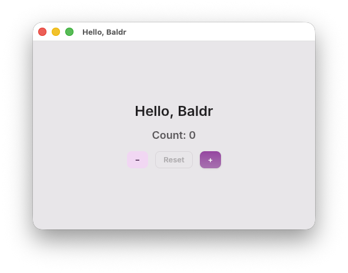
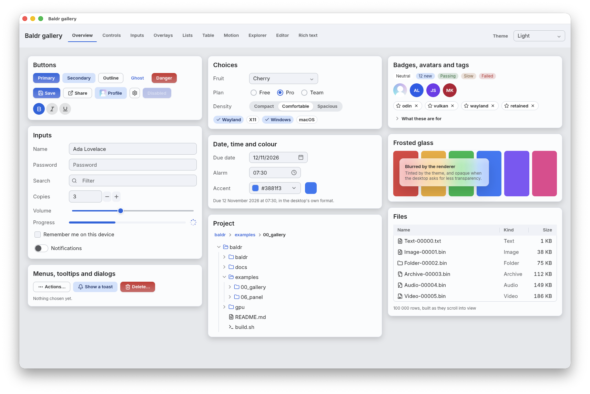
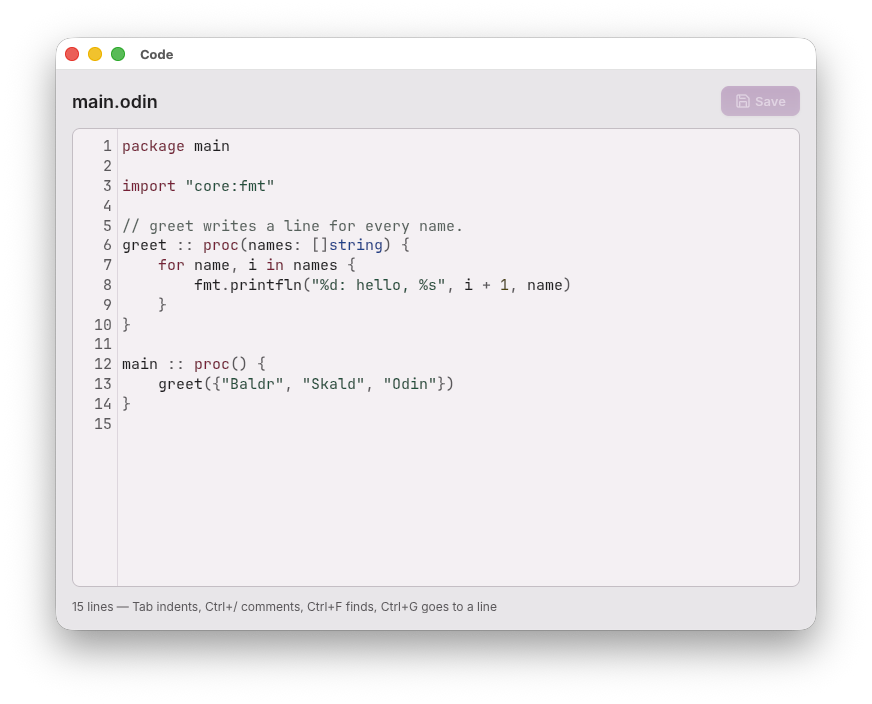
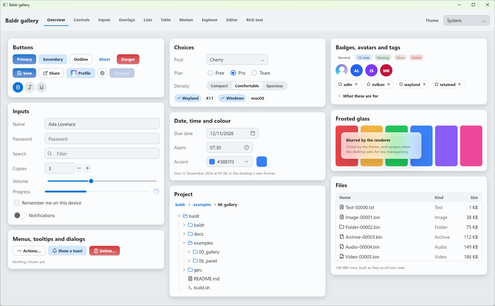
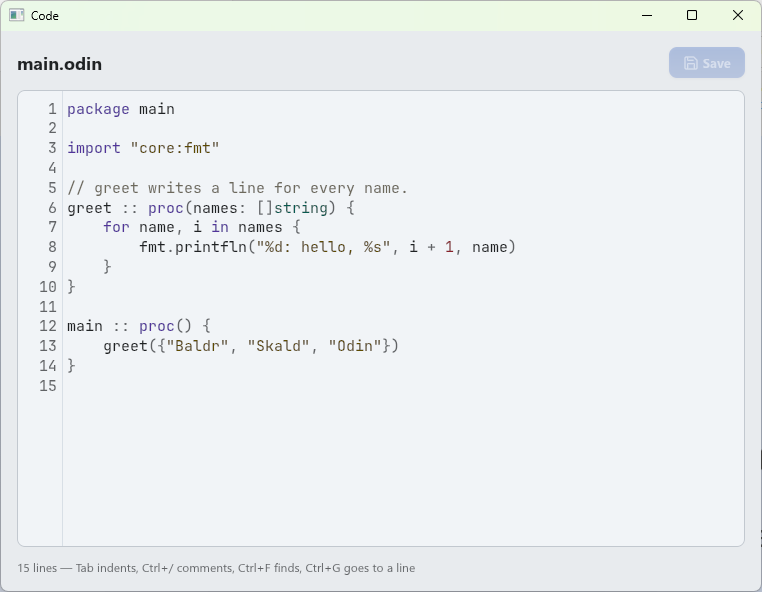

# Baldr

[](https://github.com/BuLEEto/Baldr/actions/workflows/ci.yml)

**A retained-mode GUI toolkit for Odin.** Pure Odin above the OS, a GPU
renderer per platform (Vulkan, and Metal on macOS), four window systems —
Wayland, X11, Win32, Cocoa — a modern look by default, and batteries
included.

<p align="center">
  
</p>

<p align="center">
  
  
</p>
<p align="center"><sub><code>examples/00_gallery</code>, dark and light: <code>./build.sh example 00_gallery run</code></sub></p>

You write a `State`, a `Msg` enum, an `update` and a `view`. Baldr keeps a
retained node tree, reconciles it after each message, lays it out, paints it
and renders it on the GPU — waking only when something actually happens. No
immediate-mode redraw loop, no scene graph to manage, no C in the build.

```odin
package main

import "core:fmt"
import "baldr:baldr"

State :: struct {
	count: int,
}

Msg :: enum {
	Inc,
	Dec,
	Reset,
}

update :: proc(s: ^State, m: Msg) -> baldr.Cmd(Msg) {
	switch m {
	case .Inc:   s.count += 1
	case .Dec:   s.count -= 1
	case .Reset: s.count = 0
	}
	return {}
}

view :: proc(s: ^State, ui: ^baldr.Ui(Msg)) {
	baldr.column(ui, flex = 1, gap = .lg, padding = .xxl, align = .Center, justify = .Center); defer baldr.end(ui)
	baldr.text(ui, "Hello, Baldr", role = .Headline)
	baldr.text(ui, fmt.tprintf("Count: %d", s.count), role = .Title, muted = true)
	baldr.row(ui, gap = .md); {
		defer baldr.end(ui)
		baldr.button(ui, "−", Msg.Dec, variant = .Secondary)
		baldr.button(ui, "Reset", Msg.Reset, variant = .Outline, disabled = s.count == 0)
		baldr.button(ui, "+", Msg.Inc)
	}
}

main :: proc() {
	err := baldr.run(baldr.App(State, Msg){
		title  = "Hello, Baldr",
		app_id = "baldr.hello",
		size   = {480, 320},
		update = update,
		view   = view,
	})
	if err != .None do fmt.eprintln("exit:", err)
}
```

That is `examples/01_hello`, in full. `./build.sh example 01_hello run`
opens it:

<p align="center">
  
</p>

A container opens a scope and `defer baldr.end(ui)` closes it: the children
go in a block with that line first inside, so the nesting is where you see
it. The outermost one is the exception — the proc's own braces are already
its block. [`docs/guide.md`](docs/guide.md) has the rule and the two places
it bends.

New here? **[`docs/guide.md`](docs/guide.md)** is the tour: the update/view
model, layout, events, commands, theming, accessibility and testing.

## What makes it different

**Pure Odin above the OS.** No SDL, GLFW, stb, FreeType, HarfBuzz, Skia,
GTK or Qt — and no C compiled into the tree at all. What is allowed is Odin
`core:`, Odin `vendor:` bindings to OS components (`vendor:vulkan`,
`vendor:darwin/*`), libraries the operating system ships, loaded at run time
through `core:dynlib` (the Vulkan loader, and on Linux `libwayland-client`
and `libwayland-cursor`, `libxkbcommon`, the `libxcb` family, `libpulse`,
and glibc itself for one allocator setting), and one vendored pure-Odin library: [`runa`](third_party/runa/)
for text shaping and glyph rasterisation. So `odin build` is the whole
build, with no third-party toolchain between you and a window, and the
Windows and macOS builds type-check from a Linux machine (`./build.sh
check`). Linking a program for another system still needs that system's
linker and libraries, as for any native program.

**Batteries included, and no lazy widgets.** Around 80 widgets: buttons,
fields, number and date and time and colour pickers, lists and tables and
tree views, split panes, tabs, menus and menu bars, popovers and dialogs,
toasts, a code editor, a rich-text and markdown editor, a markdown view, a
terminal, charts, node graphs, an emoji picker, an icon view with
file-manager conventions, drag and drop. Each is purpose-built — its own
pointer, keyboard, wheel and touch handling, its own accessibility mapping,
its own look — rather than assembled out of other widgets. And when none of
them is the one you need, `custom` is a widget of your own that paints and
measures itself (`examples/37_custom`).

**Accessibility is part of "done", not a later phase.** Every interactive
widget ships with a role, name and state mapping, keyboard operability and a
focus ring, with headless tests asserting its accessibility tree, and
`baldr.lint` — which the test suite runs, and an app can run over its own
views — reports any control left without an accessible name. The toolkit
follows the desktop's text size and UI font size, reduce motion and reduce
transparency.

That mapping reaches the desktop's own accessibility interface on all three
platforms: **AT-SPI2** on Linux, **NSAccessibility** on macOS and **UI
Automation** on Windows. One file decides what to say and each bridge only
turns it into its own protocol, so the three trees agree by construction.

Each has been read by a real client of that interface, walking the gallery,
reading roles, names and rectangles, and pressing a control to move the app
to another page. On Linux and macOS that includes the screen readers
themselves: **Orca**, and **VoiceOver**, which says "Elderberry, selected,
5 of 5" for the gallery's radio group and follows the arrow keys through
it. **Narrator
has not been run**, so on Windows what a reader *says* is still inferred
from what a UI Automation client is told. The Windows bridge carries the
Invoke, Toggle, Value, RangeValue and SelectionItem patterns; it does not
carry the Text pattern, so a reader there cannot yet move through a document
by line.

**Locale is first-class.** Dates, times, numbers, day names and the first
day of the week come from the desktop's locale, not from the toolkit — read
on Wayland, X11, Windows and macOS.

**Retained, so you only pay for what changed.** The view proc runs after a
message, not every frame; the reconciler diffs the node tree against the
last one; layout, paint and render do the part that moved. An idle window
costs nothing, because there is no frame.

## Baldr, Skald and runa

**[Skald](https://github.com/BuLEEto/Skald)** is my other Odin GUI framework,
and it is still actively developed. Both take the same shape — a `State`, a
`Msg`, an `update` and a `view` — and differ underneath:

| | Skald | Baldr |
|---|---|---|
| Rendering | rebuilds every frame | retained: the view runs after a message |
| Platform | SDL3, a C library to install or ship beside the app | its own Wayland, X11, Win32 and Cocoa backends over the libraries the OS ships; no C in the tree, nothing extra to install |
| State | 1.0.0-rc | pre-1.0 |

Pick **Skald** if SDL is welcome in your build and you like an
immediate-mode-shaped loop with Elm-style state. Pick **Baldr** if you want no
C in the tree, a window that costs nothing when nothing is happening, or the
shell-tier pieces — layer surfaces, applets, session lock.

**[runa](https://github.com/BuLEEto/Runa)** is the pure-Odin text engine both
of them use — shaping, bidi, line breaking, OpenType features, font fallback.
It is vendored here in [`third_party/runa/`](third_party/runa/), so Baldr
needs nothing installed to lay out text.

## What's in the box

| | |
|---|---|
| **Widgets** | about 80 widget builders, and some 25 modifiers that add to any node (a tooltip, a click, a drag, a drop target) — see [`docs/widgets.md`](docs/widgets.md) for the per-widget table (signature, behaviour, accessibility) |
| **Text** | shaping, bidi, line breaking, OpenType features, font fallback, variable fonts, emoji with skin tones, tabular figures, rich text with inline objects |
| **Theming** | follows the desktop by default: light/dark, accent, contrast, fonts and text size, a KDE colour scheme, a Windows contrast theme in the person's own colours. Global tokens (colour roles, type scale with a family per step, radii, spacing, motion, elevation, glass), a style per widget kind (`th.button`, `th.field`, `th.list_row`, … 25 of them, every field optional), compact or spacious density, a smallest target size, and a subtree with a theme of its own |
| **Graphics** | a GPU canvas an app draws into (RGBA8/16/32F, colour spaces, blend modes, filters, brushes, variable-width strokes), its own shaders, blur chains, device-loss recovery; video frames from the app's own decoder, written to a canvas or imported as a GPU buffer (dmabuf, Linux) |
| **Pictures** | PNG, JPEG, GIF, WebP, BMP, ICO, QOI, TGA, netpbm and SVG decoded in Odin (and XPM, for the icons older programs install); animated GIF and WebP play by themselves; a phone's photo is turned upright by its EXIF orientation; PNG written. A header's claimed size is checked before anything is allocated, so a hostile file is refused rather than obeyed. AVIF, HEIC, JPEG XL and TIFF are not decoded: an app decodes them and hands over the pixels |
| **Desktop integration** | notifications, tray / status items, file dialogs (the desktop portal on Linux, the system's own on Windows and macOS), clipboard and primary selection, drag and drop between apps, open-URL and reveal-in-file-manager, the OS keychain, single-instance relaunch, keep-awake |
| **Shell surfaces** (Wayland) | layer surfaces for bars and docks and launchers, applet embedding, session lock, toplevel and workspace management, backdrop blur |
| **Audio** | playback and capture of PCM on PulseAudio, WASAPI and CoreAudio. No codecs: an app decodes Opus, MP3 or FLAC with its own library and hands over the samples |
| **Untrusted input** | pictures, pastes, drops, links, notifications and other programs' messages are bounded and checked — see [the guide](docs/guide.md#untrusted-input) for what is promised |
| **Async** | commands from `update` (jobs on threads, delays, file IO, clipboard), subscriptions (timers, file watches) |
| **Testing** | layout, reconcile, paint and accessibility all run headless — 1,623 tests across 9 packages, no GPU or window needed |
| **Speed** | measured on a Ryzen 9 7900 with a Radeon RX 7600, optimised build, CPU and GPU together: the gallery's first frame 55 ms after launch; a click that changes one control 0.3 ms; a switch to another page 1.4 ms; a typed key 0.4 ms; a spinner animating 0.2 ms a frame; and an idle window draws nothing at all |
| **Footprint** | a hello world is 14 MB built optimised (13.7 MB with `-o:size`): 3.5 MB of it is the embedded fonts and most of the rest Unicode, emoji and icon tables, so text and icons work on a machine with nothing installed. An idle window uses no CPU: nothing is drawn until something changes |

## Platform support

`platform.Backend` holds 70 procs a backend fills (a 71st,
`redraw_callback`, goes the other way: the toolkit sets it and the backend
calls it from inside an OS modal loop). **22 of the 70 only the Wayland
backend fills**, and they are not all one kind:

- **13 are the shell tier**, by design: layer surfaces, applets and their
  slots, the session lock, and toplevel and workspace management. They are
  what a desktop shell needs, not what an application needs, and their
  equivalents elsewhere belong to a window manager rather than to a program.
- **1 is Wayland's own protocol**: acknowledging a configure, a dance the
  other window systems do not have.
- **5 are compositor effects with a fallback**: the blur behind a surface
  and where it falls (an opaque tint that keeps its contrast elsewhere), the
  region that takes the pointer (the whole window elsewhere), and popups as
  surfaces of their own (drawn inside the window elsewhere).
- **3 are application features the other backends do not have yet**: a
  window that draws its own title bar cannot move, resize, maximise or
  minimise itself through it (`surface_act`); a large pasted picture is read
  on the UI thread rather than on a worker (`clipboard_read`); and an app
  cannot ask for the desktop's own shortcuts, such as Super+Q, to reach it
  instead, as a remote desktop or a virtual machine wants
  (`inhibit_shortcuts`).

Run `tools/backend-coverage.py` rather than trusting these figures: it reads
the tree, and takes a backend's name to list what that one is missing.

| Platform | Backend | Renderer | State |
|---|---|---|---|
| Linux / Wayland | 68/70 | Vulkan | the reference platform; everything below is measured against it. Its two gaps are `surface_position`, which a Wayland client has no say in, and `surface_set_dark`, because there the compositor draws a window's decoration by its own theme, or the app draws its own |
| Linux / X11 | 48/70 | Vulkan | application windows: its 22 gaps are the 22 above — the shell tier, the configure dance, the effects with a fallback, and the three application features |
| Windows | 45/70 | Vulkan | application windows, clipboard, dialogs, tray, notifications, file watches, app-driven fullscreen and input methods (IMM32, composed against the Microsoft Japanese IME). Of its 25 gaps, 22 are the ones above; the other three are absences rather than gaps — no primary selection to get or set, and no accessibility bus to wake for |
| macOS | 45/70 | Metal | the newest, and level with Windows. The Metal renderer is complete and parity-checked against the CPU reference. It has the menu bar (Cmd-Q, Cmd-W, Cmd-M), the typed clipboard including a Mac's TIFF screenshots, drag and drop both ways, input methods through NSTextInputClient, the screens and a window's place on them, app-driven sizing and fullscreen, file watches through FSEvents, cursors, file dialogs, notifications, the Keychain, a status item and the desktop's locale. It draws at the rate of the screen it is on — a `CADisplayLink` per window, measured at 144.7 Hz on a 144 Hz panel where the old fixed clamp managed 49.4 — and follows the desktop's preferences as they change. Of its 25 gaps, 22 are the ones above; the other three are absences rather than gaps — no primary selection to get or set, and no accessibility bus to wake for |

<p align="center">
  
  
</p>
<p align="center"><sub>On macOS, drawn with Metal: the gallery, and the code editor from <code>examples/07_code</code>. The editor sets no theme of its own, so it follows the Mac's appearance and takes its colour from the Mac's accent.</sub></p>

<p align="center">
  
  
</p>
<p align="center"><sub>On Windows 11, drawn with Vulkan: the same two, with the gallery's theme on System, so both follow the desktop's light mode and its accent.</sub></p>

Baldr is for the desktop: there is no web, Android or iOS backend. It owns
its windows and its renderer, so it does not draw inside another engine's
window or Vulkan context.

An app degrades rather than fails where a backend cannot do something: a
layer surface becomes an undecorated window, a lock or applet call answers
that it cannot, a missing blur becomes an opaque tint that keeps its
contrast.

## Getting started

**You need Odin `dev-2026-11a` or newer**
([installing Odin](https://odin-lang.org/docs/install/)), plus what your
platform needs to link and draw:

| | You need | |
|---|---|---|
| **Linux** | a Vulkan driver (`libvulkan` and an ICD), and a Wayland or X11 session; on X11 the keyboard needs `libxkbcommon-x11`, which any desktop with Qt or GTK 4 apps has | Mesa's `lavapipe` software driver is enough to run and test. Wayland is used when it is there; `BALDR_BACKEND=x11` asks for X11 |
| **Windows** | what Odin itself needs: the MSVC build tools and a Windows SDK | Vulkan comes with every current GPU driver |
| **macOS** | the Xcode Command Line Tools (`xcode-select --install`) | it draws with Metal, which is part of the OS, so no Vulkan and no MoltenVK. Checked on Apple Silicon |

Nothing else: no package manager, no SDK of Baldr's own, no third-party library to install.

### Try it

```bash
git clone https://github.com/BuLEEto/Baldr baldr && cd baldr
./build.sh example 01_hello run         # the counter, in a window
./build.sh example 00_gallery run       # the gallery: most widgets, every theme
```

[`examples/`](examples/) lists all 40 examples, and the order to read them
in.

**On Windows**, `build.sh` is a bash script, so from `cmd` or PowerShell use
plain Odin commands. Odin does not create the output folder, so make it
first:

```bat
mkdir build
odin build examples\01_hello -collection:baldr=. -out:build\01_hello.exe -debug
build\01_hello.exe
odin test baldr -collection:baldr=.
```

**On macOS, run the `.app`, not the bare binary.** `./build.sh` wraps every
build in a bundle and runs that. A binary with no `Info.plist` beside it is
not marked high-resolution, so on a Retina screen it draws at the wrong
backing scale. `mac_bundle` in `build.sh` shows the five keys an app's own
bundle needs.

### Your own app

Baldr is used as an Odin collection, named on the command line wherever the
clone lives:

```bash
odin build myapp -collection:baldr=/path/to/baldr
```

**On Windows, ask for a GUI program**, or double-clicking your app opens a
terminal behind it — a program is a console program there unless it says
otherwise:

```bash
odin build myapp -collection:baldr=/path/to/baldr -subsystem:windows
```

Leave it off for a tool that wants a console to print to. (Older advice
passed `/SUBSYSTEM:WINDOWS /ENTRY:mainCRTStartup` to the linker; Odin's own
flag says the same thing, and the default linker on `dev-2026-11a` warns
that it cannot redefine the entry point when given `/ENTRY`.)

```odin
import "baldr:baldr"       // the toolkit
import "baldr:gpu"         // only if you draw on a canvas yourself
```

### Working on Baldr itself

```bash
./build.sh test                  # headless test suite — no GPU or window needed
./build.sh check                 # type-check every package, every target
./build.sh example 01_hello run  # the counter, in a window
./build.sh gallery               # build 00_gallery alone: the quick check after an API change
./build.sh examples              # build all 40 examples, in a couple of minutes
./build.sh api                   # regenerate docs/API.md from the doc comments
```

Useful while developing:

```bash
BALDR_FAST=1 ./build.sh example <name> run   # -o:speed; judge speed with this, not the debug build
BALDR_DEBUG_FRAMES=1 build/<name>            # per-frame phase times, atlas uploads, asked→drawn delay
BALDR_DEBUG_EVENTS=1 build/<name>            # pointer enter, hover changes, what each click hit
BALDR_DEBUG_MEMORY=1 build/<name>            # every 10 s: the heap, and the lines of code whose live memory grew
BALDR_DEBUG_BOUNDS=1 build/<name>            # name any widget that draws outside the area a repaint of it clears
BALDR_DENSITY=-1 build/<name>                # preview compact controls (=1 spacious); BALDR_THEME=dark, BALDR_TEXT_SCALE=1.5 likewise
BALDR_VALIDATE=1 build/<name>                # Vulkan validation layer (on by default in debug builds)
```

## Layout

| Path | What |
|---|---|
| `baldr/` | `package baldr` — the public API: nodes, layout, paint, events, reconciler, theme, widgets |
| `gpu/` | the renderer: Vulkan, and Metal for macOS |
| `platform/` | `platform.Backend`, the contract every backend fills, and its events |
| `platform/{wayland,x11,win32,cocoa}/` | windowing, input, clipboard, dialogs, system theme |
| `platform/{xdg,xkb}/` | the parts Wayland and X11 share: portals, notifications, locale, keymaps |
| `dbus/` | a pure-Odin D-Bus client (portals, settings, notifications, AT-SPI) |
| `sys/atspi/`, `sys/portal/` | the AT-SPI2 protocol for the Linux accessibility bridge, and the desktop portals' settings and file dialogs |
| `audio/` | PulseAudio, WASAPI, CoreAudio |
| `assets/` | the embedded fonts with their licences, and the gallery's sample pictures |
| `third_party/` | runa, the vendored pure-Odin text engine; the Lucide icons; the Unicode data licence |
| `docs/` | the guide, the widget table, the generated API reference, and the screenshots |
| `examples/` | 40 examples, [listed with where to start](examples/README.md); `00_gallery` is the gallery, `00_headless` renders without a window |
| `spikes/` | throwaway feasibility programs. Not API, not supported, kept because their findings are |
| `tools/` | the API-doc generator, the icon and emoji generators, the Wayland protocol scanner, the backend coverage count, click injectors for testing on Wayland and macOS, and the scripts that sync to the Windows and macOS build machines |

## Documentation

- **[`docs/guide.md`](docs/guide.md)** — start here: the model, layout, events, commands, theming, accessibility, testing
- **[`examples/README.md`](examples/README.md)** — the 40 examples by job, and the order to read them in
- **[`docs/widgets.md`](docs/widgets.md)** — every widget: signature, behaviour, accessibility mapping
- **[`docs/API.md`](docs/API.md)** — the full generated reference, from the doc comments
- **[`docs/a11y-expected.md`](docs/a11y-expected.md)** — what a screen reader should say for each widget: role, name, states, value
- **[`docs/audio.md`](docs/audio.md)** — the `baldr:audio` sibling package: what it does, and what each platform can do
- **[`CONTRIBUTING.md`](CONTRIBUTING.md)** — the dependency rule, the API vocabulary, how to add a widget
- **[`CHANGELOG.md`](CHANGELOG.md)** — what changed
- **[`THIRD_PARTY.md`](THIRD_PARTY.md)** — the fonts, icons, data and protocols Baldr bundles, and what shipping an app asks of you

## Status

Pre-1.0, and honest about it: the API is stable in shape but not frozen, and
the platforms are at the stages the table above describes. Linux is the
reference, Wayland first and X11 close behind it. Windows and macOS are level
with each other. The whole test suite is green on all three, and
`./build.sh check` type-checks the macOS and Windows builds from Linux on
every change. What they still lack is in the table and under *Known
limitations*.

**What the API promises.** Baldr is compiled into your app from source, so
the promise is about your code still compiling, not a binary interface:
- The public API is the first part of `docs/API.md`. The declarations after
  it are public only because Odin has no finer privacy, and are not a
  contract.
- A break is any change there that stops correct code compiling or changes
  what it does. Until 1.0 a minor version may make one, and every one is
  listed in the CHANGELOG with what to write instead.
- Not a break: a new proc, type or constant; a new named parameter with a
  default; a new field in a struct; a new value in an enum. So pass a
  builder's options by name, build structs with field names, and write
  `#partial switch` over Baldr's enums (`Key`, `Icon`, `Role`, …), which
  grow.

## How this was built — AI disclosure

Baldr is written by one person with an AI assistant: most of the code here
was typed by Claude (Anthropic's [Claude Code](https://claude.com/claude-code))
against a written design contract, under my direction and review, and the
commits carry a `Co-Authored-By` trailer saying so. I would rather say it on
the front page than leave you to work it out from a commit log.

What I would ask you to judge it by is not who typed it, but what stands in
for "a human was careful here":

- **A claim in this repo is a measurement.** 1,623 headless tests run with
  no GPU and no window, and every view they build is checked to draw only
  inside the area a repaint of it clears; the gate fails on a drawing
  outside it and on any leaked byte; `./build.sh check` type-checks every package for
  Linux, Windows and macOS; every example is built before a batch of work
  lands. A timing quoted in these docs says which build it was taken on,
  and speed is judged on the optimised one (`BALDR_FAST=1`), because a
  debug build reads up to ten times slow and once nearly earned a rewrite
  nothing needed.
- **Nothing graphical is called done from the code alone.** A rendering
  change is run, captured and looked at; anything the desktop has a say in
  — a window size, a configure, a drag crossing the window's edge — is run
  against a real compositor, because a headless test can only pin what we
  *believe* the other side does. One request shipped with four passing tests
  that pinned exactly the wrong contract, and that is why the rule is
  written down.
- **A test of something subtle that passes the first time is made to
  fail.** The change it guards is mutated and the suite re-run. A test that
  passes against a broken build is decoration, and the only way to know is
  to break the build.
- **What has not been verified says so.** The table above and the
  limitations below exist to be read before you depend on something.
  "It compiles on Windows" is not verification, and an empty list from a
  backend that cannot answer looks exactly like a real answer.
- **The decisions are mine.** The design contract, the API vocabulary and
  what counts as "done" are written down, and the assistant is held to them
  rather than asked to invent them; a request that would bend one comes back
  to me instead.

No code here is lifted from another toolkit — Baldr is not a port of GTK,
Qt or Skia — and the only third-party code, fonts and data in the tree are
the ones [`THIRD_PARTY.md`](THIRD_PARTY.md) lists. If an AI-written
dependency is a dealbreaker for you, better you know now than later.

## Known limitations

Written down rather than glossed over. None of these is a crash; each is
something to know before you build on it.

- **On macOS, Baldr draws in Inter, not the system's San Francisco**, and
  that is a decision rather than a gap. San Francisco is licensed for
  Apple-platform interfaces through Apple's own text stack, and loading its
  file into another text engine is a grey area for apps that go out to
  other people. An app that wants another face names an installed family
  with `Theme.font_family`. (The Mac's preferences *are* followed as they
  change: light and dark, reduce motion, reduce transparency and increase
  contrast.)
- **A measured backdrop is Wayland-only, and only as fine as the
  compositor's cells.** `Surface_Desc.backdrop = .Measure` and
  `backdrop_range` need a compositor protocol, so on X11, Windows and macOS
  they answer "nothing measured" for ever and an app falls back (for text on
  a desktop, to a halo). Where they do answer, the numbers are averages over
  the compositor's cells, so detail finer than a cell is invisible to them —
  a wallpaper of thin black stripes can report no black at all. Where the
  compositor reports the backdrop cell by cell, `legible_over` gives each
  piece of text the ink that reads over its *own* part rather than one for
  the whole surface; with no map it falls back to that one range.
- **A window that draws its own title bar moves only on Wayland.**
  `window_chrome` asks the desktop to move, resize, maximise or minimise the
  window through `surface_act`, which only the Wayland backend fills; on
  X11, Windows and macOS those requests answer that they cannot, so an app
  there is better off with the system's own title bar. The same three backends read a
  large pasted picture on the UI thread, and cannot pass the desktop's own
  shortcuts through to an app (see *Platform support*).
- **On Windows a reader cannot move through text by line.** The UI
  Automation bridge carries the Invoke, Toggle, Value, RangeValue and
  SelectionItem patterns but not the Text pattern, so an editor hands a
  reader its whole contents as one string and nothing finer. Linux and macOS
  both expose the per-line, per-word and caret detail.
- **The toolkit's own words are English, and layout does not mirror for
  right-to-left languages.** Dates, times and numbers follow the locale and
  right-to-left text is shaped and ordered correctly, but the few words
  Baldr writes itself (a date picker's "Today", a code block's "Copy
  code", the emoji picker's "Search") are not translated yet. Rows do not
  flip their order for Arabic or Hebrew, a right-to-left paragraph starts at
  the left edge, and the arrow keys move through such text in reading order
  rather than across the screen.
- **There is no printing.** No print dialog and no page output yet, on any
  platform; an app that prints writes a file (a PNG with `image_encode_png`,
  or its own PDF) and hands it to the system.
- **The Metal renderer's page table is a fixed 256 entries**, where Vulkan
  grows as needed, and canvases take slots beside the glyph and picture
  atlases — so a document with hundreds of canvas layers will hit it on
  macOS.
- **Importing another process's GPU buffer** (dmabuf) is verified on AMD and
  Intel; **NVIDIA is untried**, as is a buffer from a second card in the same
  machine. Multi-plane formats such as NV12 are deliberately not imported.
- **An editor's unmeasured lines are estimated by byte length**, so the
  scroll bar of a long CJK document reads generous until the reader gets
  there and the lines are measured. Nothing drawn on screen is ever placed
  from an estimate.
- **Some paths type-check and have never run**, which is a different thing
  from a limit and is listed as its own: the measured DWM frame clock and
  scale ≠ 1 on Windows, the tray's click path there, a saved window position
  reopening against a reparenting window manager, the dark-frame hint an X
  window manager reads, and two of the five GPU target faults. Cursors drawn
  from the desktop's theme (for GNOME, whose compositor has no cursor-shape
  protocol) have run in a nested compositor with the protocol switched off,
  not yet on a GNOME session. On macOS: a second screen and scale
  ≠ 1 (the box has one display at 1.00), a CJK input method (the dead-key
  composition path is the same code and is checked), and a drag that
  crosses to another program. Each is waiting on a machine somebody is
  sitting at rather than on code.
- **Audio capture has never run on real hardware on macOS or Windows** — the
  format, buffers and error mapping are exercised, the input callback is not.
  [`docs/audio.md`](docs/audio.md) has the per-platform table.

## Thanks

Baldr stands on other people's work, and it would not exist without it:

- **[Odin](https://odin-lang.org)**, Ginger Bill and its contributors: a
  language where a toolkit with no C in it is a reasonable thing to attempt,
  and whose `vendor:` bindings to Vulkan and Apple's frameworks mean the OS
  is one import away.
- **[Inter](https://rsms.me/inter/)** by Rasmus Andersson and **[JetBrains
  Mono](https://www.jetbrains.com/lp/mono/)** by JetBrains, the two faces
  every Baldr app draws with.
- **[Twemoji](https://github.com/twitter/twemoji)**, Twitter and its
  contributors, in **[Mozilla's COLRv0
  build](https://github.com/mozilla/twemoji-colr)**, for emoji that look the
  same on every platform.
- **[Lucide](https://lucide.dev)** and **[Feather](https://feathericons.com)**
  before it, for the icons.
- **[Unicode](https://www.unicode.org)**, whose data and algorithms decide
  where a line may break, which way text runs and what an emoji is.
- **The Wayland protocol authors**: freedesktop.org, wlroots and the
  compositors that write their protocols down for everyone else to use.

## License

Baldr is **zlib**: see [`LICENSE`](LICENSE). Do what you like with it; keep
the notice, and don't claim you wrote it.

What it bundles keeps its own licence, and
**[`THIRD_PARTY.md`](THIRD_PARTY.md)** lists all of it: who made it, what
Baldr uses it for, under what terms, and where the full text is.

| | |
|---|---|
| [`third_party/runa/`](third_party/runa/) | the text engine — zlib |
| [`third_party/lucide/`](third_party/lucide/) | the Lucide icon set — ISC (MIT for the icons from Feather) |
| `assets/fonts/InterVariable*.ttf` | Inter — SIL OFL 1.1 |
| `assets/fonts/JetBrainsMono-Variable.ttf` | JetBrains Mono — SIL OFL 1.1 |
| `assets/fonts/Twemoji-Mozilla.ttf` | Twemoji — CC-BY 4.0 |
| tables built from Unicode's data | [Unicode License v3](third_party/unicode/LICENSE) |
| `platform/wayland/wl/xml/` | the Wayland protocol definitions — MIT, HPND or zlib, each in its file |

**If you ship an app built on Baldr**, several of these ask that a notice
goes with it, and every Baldr binary embeds the fonts, icons and tables
whether or not it draws with them. `baldr.notices()` returns each notice in
full, following what your build actually contains, so an About box or a
credits page that shows them covers all of it.
